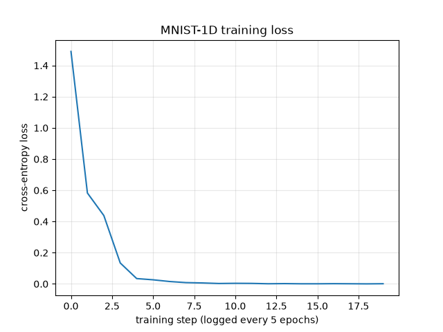
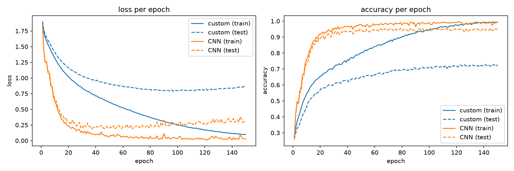

# MNIST-1D
The repo contains a custom implementation of a Neural Network trained by the [MNIST-1D](https://arxiv.org/abs/2011.14439v4) dataset through numpy and its comparision with a CNN model in pytorch, as well as research into how I did MI (Mechanistic Interpertibility Analysis) on said CNN model
--
# Plots
## Custom Implementation, training loss only

You can read the implementation details [here](./Implementation-details/main.pdf). The pdf is generated via typst.

## Comparision with a CNN model

---